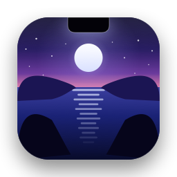

<p align="center"></p>

# Cove

One notch for the whole Mac: music and calendar, a file shelf, your coding agents, and plugins.
Built on open source (GPL-3.0), and it follows the system language (English, 简体中文, 繁體中文, 日本語 and more).

## Tabs

- **Home / Shelf** – media controls, calendar, mirror, HUDs, drag-and-drop shelf (from Boring.Notch).
- **Agents** – Claude Code, Codex, Gemini CLI, Cursor and 30+ other coding agents (from CodeIsland): live status, approve or
  deny tool calls, answer questions. Hooks are added automatically for the tools found on this Mac, after their
  configs are backed up; switch any off in **Settings → Agents**. A mascot beside the closed notch shows agent activity;
  opening the notch from it lands on this tab.
- **Plugins** – external programs that draw a tab; see [docs/PLUGINS.md](docs/PLUGINS.md).

## Layout

```
boringNotch/            the app (fork of Boring.Notch)
Packages/NotchKit       NotchModule + ModuleRegistry: the tab system
Packages/AgentHub       CodeIsland's engine, hook bridge and agent tab
Packages/PluginKit      the plugin host
Design/make_icons.swift draws the app and menu bar icons
```

Build: `xcodebuild -project boringNotch.xcodeproj -scheme boringNotch build` (needs Xcode). Each package has tests: `swift test`.

## License

GPL-3.0 (see `LICENSE`). Includes MIT-licensed code from CodeIsland, NotchGames and NotchBasket; their notices are in
`Packages/*/LICENSE-*`.

## Install and update

Download `Cove.dmg` from the [latest release](https://github.com/Icarus603/cove/releases/latest), drag Cove to
Applications. The build is signed ad hoc (no Apple Developer ID), so the first time: right-click Cove → Open, or allow it
in **System Settings → Privacy & Security**. After that Cove updates itself through Sparkle; **About → Check for Updates**
forces a check.

## Releasing

```bash
scripts/package.sh                 # Release build, ad-hoc signed, build/Cove.dmg
scripts/make-appcast.sh 1.0.0      # build/appcast.xml, signed with the Sparkle key in your Keychain
gh release create v1.0.0 build/Cove.dmg build/appcast.xml --title "Cove 1.0.0"
```

The feed is `releases/latest/download/appcast.xml`, so every release uploads both files. Keep the Sparkle private key:
losing it means installed copies can no longer verify updates. Bump `MARKETING_VERSION` and `CURRENT_PROJECT_VERSION`
before each release.
