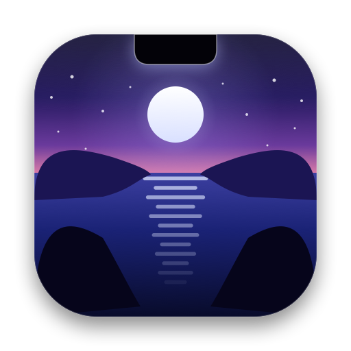

<div align="center">


<br>

[](https://github.com/Icarus603/cove/releases/latest)
[](#安装)
[](#安装)
[](LICENSE)

[English](README.md) · [繁體中文](README.zh-Hant.md) · **简体中文**

[为什么做 Cove](#为什么做-cove) · [安装](#安装) · [怎么使用](#怎么使用-cove) · [功能](#功能) · [从源代码构建](#从源代码构建) · [插件](docs/PLUGINS.md)

</div>

---

## 为什么做 Cove

刘海是屏幕上永远存在、却从来没人用的一块地方。Cove 把它变成一个安静的小仪表板：鼠标移上去就展开，离开就收起。所有功能都放在分页里，你只会看到自己要用的那一个。

它有三条原则：

- **你的文件留在原处。** 播放器和相簿只记住文件的位置（你搬动文件它也找得到），不拷贝、不搬移，也不把你锁进私有资料库。从资料库移除东西，永远不会删掉文件。
- **涉及金钱的地方一律只读。** 行情只显示价格，加上只读密钥时显示你的资产。Cove 不会下单，也不会要求能下单的密钥。
- **看起来像你自己选的。** 每个控制项都用你自订的强调色，界面跟着系统语言走。

## 安装



需要 **macOS 14 或更新版本**，原生支持 Apple Silicon。

1. 从[最新版本](https://github.com/Icarus603/cove/releases/latest)下载 `Cove.dmg`，把 Cove 拖进「应用程序」。
2. Cove 没有经过 Apple 公证，所以第一次要：对 Cove 右键点击 →「打开」，或到 **系统设置 → 隐私与安全性** 允许。
3. 之后 Cove 会透过 [Sparkle](https://sparkle-project.org) 自己更新：启动时和每小时检查，并在不会打扰你的时候（刘海收合、设置窗口关闭、没有智能体在等你）自动安装。**关于 → 检查更新** 可手动检查。

## 怎么使用 Cove

### 最初的一分钟

1. **启动 Cove。** 一段简短的欢迎画面会询问选用功能需要的权限（镜子要相机、行事历与提醒事项、辅助功能、音乐）。只授权你会用到的，其他功能没有这些权限也能用。
2. **展开刘海。** 把鼠标移到刘海上停一下就会展开，移开就收起。（可在 **设置 → 通用** 改成点击才展开。）
3. **切换分页**：用上方的图标切换主页、暂存器、播放器、相簿、记事本、行情、智能体。
4. **打开设置**：点展开后的齿轮，或菜单栏上的 Cove 图标。**设置 → 模块** 决定要显示哪些分页，**功能** 底下的各页负责设置每个分页。
5. **变成你的。** **设置 → 高级** 可自订强调色，所有侧栏、按钮和焦点框都会跟着变。

### 播放你自己的音频和视频（播放器）

1. 打开**播放器**分页，按 **＋ 添加**，选文件或整个文件夹（子文件夹也会加进去）。标签和封面 Cove 会帮你读。
2. 点一下标题就播放。把鼠标移到某一列，会出现 **⋯**，里面有「下一个播放」、「添加到队列」、「添加到播放列表」、「在访达中显示」等。
3. 用**全部／音频／视频**筛选；你的播放列表接在同一排后面，太多时可左右滑动。上方可搜索，⇅ 菜单可排序。
4. **创建播放列表：** 按这一排右边的 **＋ 播放列表**，取名后，在要放进去的项目上按 **＋**。或者在「添加」对话框里选「同时加入播放列表」，新文件一加入就直接放进去。
5. **一次处理很多**要在资料库窗口（见第 8 点）：点击、**Shift** 连选范围、**Command** 逐行加选。刘海里的列表是用来播放的：点一下就播。
6. **把播放列表排好顺序：** 在播放列表里，⇅ 菜单可依文件名、依标题整理或反转顺序；某一列的 **⋯** 可以上移或下移。
7. **视频**在刘海里播放。双击、按 **F** 或用按钮就能全屏；用箭头按钮可弹出为独立窗口。停止操作后，控制栏和光标会自动淡出。
8. **大量处理时**，打开 **⋯ →「管理资料库…」**：一个完整窗口，有可依任一栏排序的表格、全选、一次移除多个，侧栏是所有播放列表。

> Cove 无法加入的文件（mkv、webm，或用 VP9、AV1 编码的视频）会列出原因和转换格式的方法。你搬动过的文件会自动找回；已经不见的会显示「找不到文件」，并有「查找文件…」按钮。

### 用相簿整理照片（相簿）

1. 打开**相簿**分页，按 **＋ 添加**，选照片或文件夹。在对话框里选「同时加入相簿」，照片进来时就直接放进现有的相簿，或你取名的新相簿。
2. 分页里有一排快速浏览的缩略图。按**打开相簿**进入大窗口。
3. **相簿列表**在侧栏。按「添加相簿」创建，或选择照片后按「加入相簿」。按「选择」进入选择状态（逐张点击、**Shift** 连选范围，或按「全选」），完成后按「完成」；不在这个状态时，点一下就是打开照片。
4. **手动排相簿顺序。** 在某个相簿里，把照片拖到另一张前面，或选择照片后用「整理顺序 → 移到最前／往前移一格／往后移一格／移到最后」。新加入的照片排在最后。⇅ 菜单也能切换成依日期、文件名或最近添加。
5. **点一下**照片，就以一张单纯的大图打开。鼠标一动，才浮出少数控制钮。为了让画面干净，大图上没有关闭钮：按 **Esc** 回到缩略图墙（若已放大，第一下先缩回适合大小）。

| 在查看器里 | |
| --- | --- |
| ← / → | 上一张／下一张 |
| 空白键 | 开始或停止幻灯片 |
| 双击、**+** / **−**、捏合 | 缩放；**0** 符合窗口，**1** 原始大小 |
| **I** | 信息（文件名、日期、大小、相簿、文件夹） |
| **F** | 全屏 |
| Esc | 先缩回，再关闭 |

### 随手记一点东西（记事本）

1. 打开**记事本**分页，按**新建**。点右边那一页就能写，第一行就是标题。写完按 **Esc**，或点一下别的地方。打字时会自动保存。
2. 左边是记事列表，最近编辑的排最前面，可以用任何一个字搜索。
3. 记事上的箭头可以把它导出成 **Markdown** 文件（文字原样输出，文件名取第一行）；垃圾桶会先问一次再删除。**设置 → 记事本** 可以把全部记事导出到一个文件夹，一则一个文件。

> 记事是纯文本，存在这台 Mac 的 `~/Library/Application Support/Cove/Notes/notes.json`，不会发送到任何地方。

### 看行情（行情）

1. 打开**行情**分页，用搜索加入交易对，它们会变成实时更新的卡片。
2. 点卡片看图表：卷动或捏合缩放，拖拽回看历史，鼠标移上去显示十字线和详细数据。可切换周期，也能打开 SMA、EMA、RSI、MACD 或布尔通道。
3. **设置 → 行情** 有涨跌颜色、「隐藏余额」开关，以及选填的**只读** Binance API 密钥（用来显示你的资产）。Cove 无法交易，也请你永远不要给它能交易的密钥。

### 看你的代码智能体（智能体）

1. 照平常的方式在终端机或编辑器里启动 Claude Code、Codex、Gemini CLI、Cursor 或其他 30 多种代理。
2. 收合的刘海旁有只吉祥物显示它们在做什么。从它展开刘海，会直接落在**智能体**分页：每个工作阶段的状态，以及等你处理的工具调用或问题。
3. 在那里直接**批准或拒绝**工具调用，或回答问题。
4. **设置 → 智能体 → 连接** 列出 Cove 在这台 Mac 上找到的工具。加入 hook 前会先备份它们的设置，也可以逐一关闭。

### 用暂存器搬文件

**把文件拖到刘海上**，暂放在暂存器，再拖到别的 App，或用 AirDrop 传出去。在 Cove 里，拖放永远代表暂存器；播放器和相簿资料库用的是各自的「添加」按钮。

### 插件

插件是一个文件夹，内含 manifest 和一个可执行文件，自己画一个分页。用 **设置 → 模块 → 插件 → 添加插件…** 加入（或把文件夹放进 `~/Library/Application Support/Cove/Plugins/`），它就会出现在刘海里。写法见 [docs/PLUGINS.md](docs/PLUGINS.md)。

## 功能

| 分页 | 内容 |
| --- | --- |
| **主页** | 正在播放的控制、行事历、镜子和系统 HUD。 |
| **暂存器** | 可拖放文件的暂存架，内置 AirDrop。 |
| **播放器** | 音频与视频资料库，有播放列表、队列、弹出窗口和迷你播放器。 |
| **相簿** | 只记录位置的相簿资料库，由你自己建相簿，有大窗口和刘海内的快速浏览。 |
| **记事本** | 纯文本记事，可搜索、可导出 Markdown，存在这台 Mac 上。 |
| **行情** | Binance 实时价格与 K 线图。 |
| **智能体** | Claude Code、Codex、Gemini CLI、Cursor 等 30 多种代码代理的实时状态。 |
| **插件** | 自己画一个分页的外部程序。 |

### 播放器

- **格式：** mp3、m4a、aac、flac、wav、aiff、caf、mp4、m4v、mov，由系统的媒体引擎播放。
- **资料库：** 可加入文件或整个文件夹；标签和封面自动读取；可搜索、筛选、排序，并从上次停下的地方继续。
- **播放列表：** 可手动、依文件名或依标题整理；可在「添加」对话框里直接放进某个列表；要多选请到资料库窗口。
- **播放：** 随机、重复、速度、音量、音频与字幕轨、接下来播放的队列。
- **视频：** 在刘海内、可调整大小的弹出窗口或全屏播放，控制栏会自动淡出。
- **迷你播放器：** 播放时，收合的刘海旁会出现小封面（视频则是实时的小画面）。
- **资料库窗口：** 有完整表格可做批量作业。

### 相簿

- **相簿由你自己建。** 不做时间轴，也不猜文件夹：自己建相簿、批量加入，并手动排每个相簿的顺序。
- **格式：** JPEG、PNG、HEIC、TIFF、GIF（会动）、WebP、BMP。RAW 和设计档会被点名说明并略过。
- **查看器：** 缩放、平移、原始大小、幻灯片、信息、全屏；打开一张照片只会看到那张图。
- **为大型资料库设计：** 使用 SQLite，缩略图按需产生，列表立刻打开（测试中导入 3,000 张照片不到一秒）。
- 丢失的文件（例如没接上的硬盘）会显示为丢失，不会被默默丢掉。

### 行情

- Binance 的实时价格与 K 线图，由逐笔成交数据流和本地订单簿更新，不是轮询。
- 可缩放、可卷动的历史，有十字线与详细提示；SMA、EMA、RSI、MACD 和布尔通道。
- 有搜索功能的自选列表，涨跌颜色可自订。
- 只读。**Cove 无法交易。**

### 智能体

来自 [CodeIsland](https://github.com/wxtsky/CodeIsland)：Claude Code、Codex、Gemini CLI、Cursor 等 30 多种代码代理的实时状态；可在刘海里批准工具调用、回答问题；收合的刘海旁有只吉祥物，从它展开刘海会直接落在这个分页。

### 主页、暂存器和插件

媒体控制、行事历、镜子、HUD 和拖放暂存架来自 [Boring.Notch](https://github.com/TheBoredTeam/boring.notch)。

### 通用

- **自动更新**（见[安装](#安装)）。
- **你的强调色**套用在每个侧栏、按钮和焦点框。
- **语言：** 英文、简体中文、繁体中文等，跟随系统语言。

## 从源代码构建

需要 Xcode。

```bash
xcodebuild -project boringNotch.xcodeproj -scheme boringNotch build
```

每个套件都有自己的测试：在 `Packages/NotchKit`、`Packages/AgentHub`、`Packages/PluginKit` 里运行 `swift test`。播放器与相簿逻辑的无头检查在 `scripts/`（`test-player.sh`、`test-indicators.sh`）和截屏测试脚本（`scripts/shots.sh`）里。`python3 scripts/make_banner.py` 会重新绘制上面的横幅。

### 目录结构

```
boringNotch/              应用程序本体（Boring.Notch 的分支）
  modules/                播放器、相簿、记事本、行情等分页
Packages/NotchKit         NotchModule 与 ModuleRegistry：分页系统
Packages/AgentHub         CodeIsland 的引擎、hook 桥接和代理分页
Packages/PluginKit        插件宿主
Design/make_icons.swift   绘制 App 与菜单栏图标
scripts/                  打包、更新源、横幅与测试脚本
docs/                     插件指南与 README 图片
```

## 发版

```bash
scripts/package.sh                 # Release 构建、签名，产生 build/Cove.dmg
scripts/make-appcast.sh 1.0.0      # 产生 build/appcast.xml，用钥匙串里的 Sparkle 密钥签名
gh release create v1.0.0 build/Cove.dmg build/appcast.xml --title "Cove 1.0.0"
```

更新源是 `releases/latest/download/appcast.xml`，所以每次发版都要上传这两个文件。请保管好 Sparkle 私钥：丢失后，已安装的 Cove 就无法验证更新。每次发版前要提高 `MARKETING_VERSION` 和 `CURRENT_PROJECT_VERSION`。

## 许可证

[GPL-3.0](LICENSE)。包含来自 CodeIsland 的 MIT 许可证代码，许可证声明在 `Packages/AgentHub/LICENSE-CodeIsland`。

## 致谢

Cove 创建在 [Boring.Notch](https://github.com/TheBoredTeam/boring.notch) 和 [CodeIsland](https://github.com/wxtsky/CodeIsland) 之上，并使用 [Sparkle](https://sparkle-project.org) 更新。感谢它们的作者。
