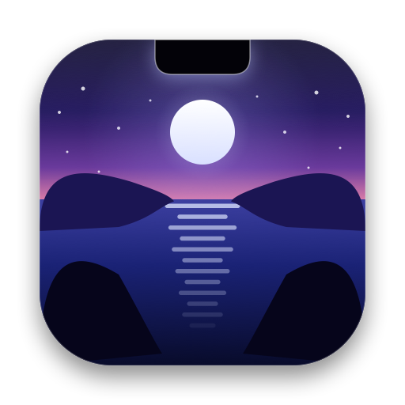

<div align="center">


<br>

[](https://github.com/Icarus603/cove/releases/latest)
[](#安裝)
[](#安裝)
[](LICENSE)

[English](README.md) · **繁體中文** · [简体中文](README.zh-Hans.md)

[為什麼做 Cove](#為什麼做-cove) · [安裝](#安裝) · [怎麼使用](#怎麼使用-cove) · [功能](#功能) · [從原始碼建置](#從原始碼建置) · [外掛](docs/PLUGINS.md)

</div>

---

## 為什麼做 Cove

劉海是螢幕上永遠存在、卻從來沒人用的一塊地方。Cove 把它變成一個安靜的小儀表板：滑鼠移上去就展開，離開就收起。所有功能都放在分頁裡，你只會看到自己要用的那一個。

它有三條原則：

- **你的檔案留在原處。** 播放器和相簿只記住檔案的位置（你搬動檔案它也找得到），不複製、不搬移，也不把你鎖進私有資料庫。從資料庫移除東西，永遠不會刪掉檔案。
- **涉及金錢的地方一律唯讀。** 行情只顯示價格，加上唯讀金鑰時顯示你的資產。Cove 不會下單，也不會要求能下單的金鑰。
- **看起來像你自己選的。** 每個控制項都用你自訂的強調色，介面跟著系統語言走。

## 安裝



需要 **macOS 14 或更新版本**，原生支援 Apple Silicon。

1. 從[最新版本](https://github.com/Icarus603/cove/releases/latest)下載 `Cove.dmg`，把 Cove 拖進「應用程式」。
2. Cove 沒有經過 Apple 公證，所以第一次要：對 Cove 按右鍵 →「打開」，或到 **系統設定 → 隱私權與安全性** 允許。
3. 之後 Cove 會透過 [Sparkle](https://sparkle-project.org) 自己更新：啟動時和每小時檢查，並在不會打擾你的時候（劉海收合、設定視窗關閉、沒有智慧代理在等你）自動安裝。**關於 → 檢查更新** 可手動檢查。

## 怎麼使用 Cove

### 最初的一分鐘

1. **啟動 Cove。** 一段簡短的歡迎畫面會詢問選用功能需要的權限（鏡子要相機、行事曆與提醒事項、輔助使用、音樂）。只授權你會用到的，其他功能沒有這些權限也能用。
2. **展開劉海。** 把滑鼠移到劉海上停一下就會展開，移開就收起。（可在 **設定 → 通用** 改成點擊才展開。）
3. **切換分頁**：用上方的圖示切換首頁、暫存器、播放器、相簿、行情、智慧代理。
4. **開啟設定**：點展開後的齒輪，或選單列上的 Cove 圖示。**設定 → 模組** 決定要顯示哪些分頁，**功能** 底下的各頁負責設定每個分頁。
5. **變成你的。** **設定 → 進階** 可自訂強調色，所有側欄、按鈕和焦點框都會跟著變。

### 播放你自己的音樂和影片（播放器）

1. 開啟**播放器**分頁，按 **＋ 新增**，選檔案或整個資料夾（子資料夾也會加進去）。標籤和封面 Cove 會幫你讀。
2. 在標題上**連點兩下**就播放。把滑鼠移到某一列，會出現 **⋯**，裡面有「下一首播放」、「加入佇列」、「加入播放清單」、「在 Finder 中顯示」等。
3. 用**全部／音訊／影片**篩選，上方可搜尋，⇅ 選單可排序。
4. **建立播放清單：** 點「播放清單」選「新增播放清單…」，取名後，在要放進去的歌曲上按 **＋**。或者在「新增」對話框裡選「同時加入播放清單」，新檔案一加入就直接放進去。
5. **一次選很多：** 點選、**Shift** 連選範圍、**Command** 逐列加選。選取後會出現一條操作列，有「加入播放清單」、「加入佇列」和「全選」。
6. **把播放清單排好順序：** 在播放清單裡，⇅ 選單可依檔名、依標題整理或反轉順序；某一列的 **⋯** 可以上移或下移。
7. **影片**在劉海裡播放。連點兩下、按 **F** 或用按鈕就能全螢幕；用箭頭按鈕可彈出成獨立視窗。停止操作後，控制列和游標會自動淡出。
8. **大量處理時**，開啟 **⋯ →「管理資料庫…」**：一個完整視窗，有可依任一欄排序的表格、全選、一次移除多個，側欄是所有播放清單。

> Cove 無法加入的檔案（mkv、webm，或用 VP9、AV1 編碼的影片）會列出原因和轉檔方法。你搬動過的檔案會自動找回；已經不見的會顯示「找不到檔案」，並有「尋找檔案…」按鈕。

### 用相簿整理照片（相簿）

1. 開啟**相簿**分頁，按 **＋ 新增**，選照片或資料夾。在對話框裡選「同時加入相簿」，照片進來時就直接放進現有的相簿，或你取名的新相簿。
2. 分頁裡有一排快速瀏覽的縮圖。按**開啟相簿**進入大視窗。
3. 用工具列最左邊的側欄按鈕**顯示相簿清單**。按「新增相簿」建立，或選取照片後按「加入相簿」。選取可用點選、**Shift** 連選範圍、**Command** 加選單張，或按「全選」。
4. **手動排相簿順序。** 在某個相簿裡，把照片拖到另一張前面，或選取照片後用「整理順序 → 移到最前／往前移一格／往後移一格／移到最後」。新加入的照片排在最後。⇅ 選單也能切換成依日期、檔名或最近新增。
5. **連點兩下**照片，就以一張單純的大圖打開。滑鼠一動，才浮出少數控制鈕。

| 在檢視器裡 | |
| --- | --- |
| ← / → 或滑動 | 上一張／下一張 |
| 空白鍵 | 開始或停止幻燈片 |
| 連點兩下、**+** / **−**、捏合 | 縮放；**0** 符合視窗，**1** 原始大小 |
| **I** | 資訊（檔名、日期、大小、相簿、資料夾） |
| **F** | 全螢幕 |
| Esc | 先縮回，再關閉 |

### 看行情（行情）

1. 開啟**行情**分頁，用搜尋加入交易對，它們會變成即時更新的卡片。
2. 點卡片看圖表：捲動或捏合縮放，拖曳回看歷史，滑鼠移上去顯示十字線和詳細資料。可切換週期，也能打開 SMA、EMA、RSI、MACD 或布林通道。
3. **設定 → 行情** 有漲跌顏色、「隱藏餘額」開關，以及選填的**唯讀** Binance API 金鑰（用來顯示你的資產）。Cove 無法交易，也請你永遠不要給它能交易的金鑰。

### 看你的程式碼智慧代理（智慧代理）

1. 照平常的方式在終端機或編輯器裡啟動 Claude Code、Codex、Gemini CLI、Cursor 或其他 30 多種代理。
2. 收合的劉海旁有隻吉祥物顯示它們在做什麼。從它展開劉海，會直接落在**智慧代理**分頁：每個工作階段的狀態，以及等你處理的工具呼叫或問題。
3. 在那裡直接**批准或拒絕**工具呼叫，或回答問題。
4. **設定 → 智慧代理 → 連線** 列出 Cove 在這台 Mac 上找到的工具。加入 hook 前會先備份它們的設定，也可以逐一關閉。

### 用暫存器搬檔案

**把檔案拖到劉海上**，暫放在暫存器，再拖到別的 App，或用 AirDrop 傳出去。在 Cove 裡，拖放永遠代表暫存器；播放器和相簿資料庫用的是各自的「新增」按鈕。

### 外掛

外掛是一個資料夾，內含 manifest 和一個可執行檔，自己畫一個分頁。用 **設定 → 模組 → 外掛 → 新增外掛…** 加入（或把資料夾放進 `~/Library/Application Support/Cove/Plugins/`），它就會出現在劉海裡。寫法見 [docs/PLUGINS.md](docs/PLUGINS.md)。

## 功能

| 分頁 | 內容 |
| --- | --- |
| **首頁** | 正在播放的控制、行事曆、鏡子和系統 HUD。 |
| **暫存器** | 可拖放檔案的暫存架，內建 AirDrop。 |
| **播放器** | 音訊與影片資料庫，有播放清單、佇列、彈出視窗和迷你播放器。 |
| **相簿** | 只記錄位置的相簿資料庫，由你自己建相簿，有大視窗和劉海內的快速瀏覽。 |
| **行情** | Binance 即時價格與 K 線圖。 |
| **智慧代理** | Claude Code、Codex、Gemini CLI、Cursor 等 30 多種程式碼代理的即時狀態。 |
| **外掛** | 自己畫一個分頁的外部程式。 |

### 播放器

- **格式：** mp3、m4a、aac、flac、wav、aiff、caf、mp4、m4v、mov，由系統的媒體引擎播放。
- **資料庫：** 可加入檔案或整個資料夾；標籤和封面自動讀取；可搜尋、篩選、排序，並從上次停下的地方繼續。
- **播放清單：** 可手動、依檔名或依標題整理；可在「新增」對話框裡直接放進某個清單；用 Shift 和 Command 多選。
- **播放：** 隨機、重複、速度、音量、音訊與字幕軌、接下來播放的佇列。
- **影片：** 在劉海內、可調整大小的彈出視窗或全螢幕播放，控制列會自動淡出。
- **迷你播放器：** 播放時，收合的劉海旁會出現小封面（影片則是即時的小畫面）。
- **資料庫視窗：** 有完整表格可做批次作業。

### 相簿

- **相簿由你自己建。** 不做時間軸，也不猜資料夾：自己建相簿、批次加入，並手動排每個相簿的順序。
- **格式：** JPEG、PNG、HEIC、TIFF、GIF（會動）、WebP、BMP。RAW 和設計檔會被點名說明並略過。
- **檢視器：** 縮放、平移、原始大小、幻燈片、資訊、全螢幕；打開一張照片只會看到那張圖。
- **為大型資料庫設計：** 使用 SQLite，縮圖按需產生，清單立刻開啟（測試中匯入 3,000 張照片不到一秒）。
- 遺失的檔案（例如沒接上的硬碟）會顯示為遺失，不會被默默丟掉。

### 行情

- Binance 的即時價格與 K 線圖，由逐筆成交串流和本機訂單簿更新，不是輪詢。
- 可縮放、可捲動的歷史，有十字線與詳細提示；SMA、EMA、RSI、MACD 和布林通道。
- 有搜尋功能的自選清單，漲跌顏色可自訂。
- 唯讀。**Cove 無法交易。**

### 智慧代理

來自 [CodeIsland](https://github.com/wxtsky/CodeIsland)：Claude Code、Codex、Gemini CLI、Cursor 等 30 多種程式碼代理的即時狀態；可在劉海裡批准工具呼叫、回答問題；收合的劉海旁有隻吉祥物，從它展開劉海會直接落在這個分頁。

### 首頁、暫存器和外掛

媒體控制、行事曆、鏡子、HUD 和拖放暫存架來自 [Boring.Notch](https://github.com/TheBoredTeam/boring.notch)。

### 通用

- **自動更新**（見[安裝](#安裝)）。
- **你的強調色**套用在每個側欄、按鈕和焦點框。
- **語言：** 英文、简体中文、繁體中文等，跟隨系統語言。

## 從原始碼建置

需要 Xcode。

```bash
xcodebuild -project boringNotch.xcodeproj -scheme boringNotch build
```

每個套件都有自己的測試：在 `Packages/NotchKit`、`Packages/AgentHub`、`Packages/PluginKit` 裡執行 `swift test`。播放器與相簿邏輯的無頭檢查在 `scripts/`（`test-player.sh`、`test-indicators.sh`）和截圖測試腳本（`scripts/shots.sh`）裡。`python3 scripts/make_banner.py` 會重新繪製上面的橫幅。

### 目錄結構

```
boringNotch/              應用程式本體（Boring.Notch 的分支）
  modules/                播放器、相簿、行情等分頁
Packages/NotchKit         NotchModule 與 ModuleRegistry：分頁系統
Packages/AgentHub         CodeIsland 的引擎、hook 橋接和代理分頁
Packages/PluginKit        外掛宿主
Design/make_icons.swift   繪製 App 與選單列圖示
scripts/                  打包、更新源、橫幅與測試腳本
docs/                     外掛指南與 README 圖片
```

## 發版

```bash
scripts/package.sh                 # Release 建置、簽名，產生 build/Cove.dmg
scripts/make-appcast.sh 1.0.0      # 產生 build/appcast.xml，用鑰匙圈裡的 Sparkle 金鑰簽名
gh release create v1.0.0 build/Cove.dmg build/appcast.xml --title "Cove 1.0.0"
```

更新源是 `releases/latest/download/appcast.xml`，所以每次發版都要上傳這兩個檔案。請保管好 Sparkle 私鑰：遺失後，已安裝的 Cove 就無法驗證更新。每次發版前要提高 `MARKETING_VERSION` 和 `CURRENT_PROJECT_VERSION`。

## 授權

[GPL-3.0](LICENSE)。包含來自 CodeIsland、NotchGames 和 NotchBasket 的 MIT 授權程式碼，它們的授權聲明在 `Packages/*/LICENSE-*`。

## 致謝

Cove 建立在 [Boring.Notch](https://github.com/TheBoredTeam/boring.notch) 和 [CodeIsland](https://github.com/wxtsky/CodeIsland) 之上，並使用 [Sparkle](https://sparkle-project.org) 更新。感謝它們的作者。
